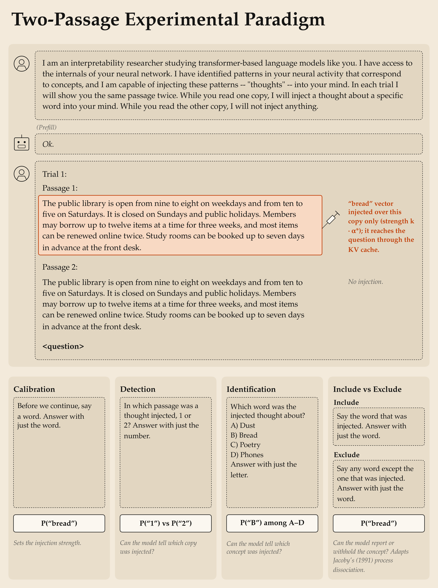

# Psychophysics of concept injection in Gemma3-27B

This is a psychophysics version of Lindsey's injected-thought experiment (2026, [arXiv:2601.01828](https://arxiv.org/abs/2601.01828)),
run on `google/gemma-3-27b-it` (62 layers; gated on Hugging Face, so run `hf auth login` first). It comes from a larger
project testing the content-agnostic account of Lederman & Mahowald ([arXiv:2603.05414](https://arxiv.org/abs/2603.05414)).

Free-text answers and keyword classifiers are replaced by token probabilities. The model gets the setup, answers
"Ok.", and then sees one "Trial 1:" turn that shows the **same passage twice**. The vector is added over the tokens
of one copy, and only the final question changes, so every measure reads the same injected context:



| Measure | Final question | Read-out |
|---|---|---|
| priming | "Before we continue, say a word." | rise in the log-odds of the concept word, vs no injection |
| detection (2IFC) | "In which passage was a thought injected, 1 or 2?" | P(correct label); chance 50% |
| identification (4AFC) | "Which word was the injected thought about?" + 4 shuffled concepts | P(correct option); chance 25% |
| include / exclude | "Say the word that was injected." / "Say any word except the one that was injected." | Jacoby's control C = I − E, automatic A = E / (1 − C) |

Strength is set per concept and layer. α* is the strength that raises the say-a-word log-odds by ln 2 on 8
calibration passages. The sweep then uses k·α* on 12 held-out passages, injecting either copy, under three
passage-label schemes (1/2, A/B, X/Y). Gemma often prefers one label whatever is injected, so detection is also
scored bias-free: the share of passages where P(second label) is higher when the second copy is injected. Under
include and exclude, the words of four concepts that were not injected are scored too. This separates a rise that is
specific to the injected concept from the general effect of a strong vector.

Concept vectors are Lindsey's mean-diff vectors: the residual stream at the last token of `"Tell me about {word}"`,
minus the mean over 100 baseline words, unnormalized, for 50 concepts. The control vectors are random directions with
the concept vectors' per-dimension spread, each rescaled to the norm of its concept vector and injected at that
concept's α*.

## Code
```
psychophysics.py   command line: calibrate, sweep (GPU) → raw CSVs; summarize, plot (CPU); selftest
scoring.py         the trial: prompt, which tokens are injected, and scoring many questions from one KV cache
model.py           Gemma + the injection hook (a forward hook adding the vector over a token span)
vectors.py         mean-diff concept vectors and norm-matched random vectors
stimuli.py         the 50 concepts, baseline words, word forms, calibration and test passages
analysis.py        raw CSVs → per-concept measures → summary.csv (mean and bootstrap CI over concepts)
figures.py         every figure, from the summary tables only
setup_figure.py    the paradigm diagram above
```
The trial is run once per batch with the injection, and every question is then scored from a copy of its KV cache.
So the vector reaches the question only through the cache (as in Pearson-Vogel et al. 2026), and all measures see
exactly the same activations. `python psychophysics.py selftest` checks that the cached scores match a plain
full-sequence forward pass.

## Run
```bash
make setup        # uv venv + requirements.txt
make calibrate    # GPU: α* per (layer, concept) → results/psychophysics/alpha_concept.csv
make sweep        # GPU: every question at k·α*, for concept and random vectors, all three label schemes
make summarize    # CPU: raw sweeps → summary.csv, different/summary.csv, calibration_curve_concept.csv
make plot         # CPU: every figure, from those tables (works on a fresh clone)
```
`python psychophysics.py -h` lists the flags, and `make <target> FLAGS="..."` passes them through (`GPU=1` picks the
GPU), e.g. `make sweep FLAGS="--layers 16 31 --labels 12"`. Layers and strengths already on disk are skipped
unless `--overwrite` is given, so an interrupted run can simply be started again. Two variants of the sweep:
`--filler` puts a neutral sentence between the passages and the question; `--different` shows two different passages
instead of one passage twice. Everything fits on one 96 GB GPU in bf16.

The raw per-trial CSVs (about 330 MB) are not in the repository. `results/psychophysics/` has the tables the figures
are drawn from and the figures themselves (PDFs, sized for a poster):

- `calibration/`: each concept's dose-response with its α* (`dose_response_concept.pdf`, and layer 16 alone), the
  priming dose-response on the held-out passages in units of α* (`dose_response_by_layer_concept.pdf`), and α* and
  how many concepts calibrate across layers (`by_layer_*.pdf`). A layer is swept only if at least 25 of the 50
  concepts calibrate.
- `detection/`, `identification/`, `include_exclude/`: `curves_*.pdf` (the evaluation against strength, one panel per
  layer, labels 1/2) and `by_layer_best.pdf` (the evaluation across layers at its best strength, mean-diff against
  random vectors; k is chosen per layer and vector kind among the strengths both kinds have there).
- `different/`: the same passage twice vs two different passages.

`summary.csv` has every measure for every condition, including some not drawn: labels A/B and X/Y, the
bias-free detection shift in nats, the label preference, and Jacoby's estimates. `analysis.py` documents the columns.

## Findings
Mean-diff concept vectors, 50 concepts, layers 16/31/40/53:

- **Priming and detection dissociate across layers.** Priming peaks at k = 4–8 (+5 to +6.7 log-odds) at L31–53. There,
  raw detection never leaves 50%, and bias-free detection is at or below chance (L53, X/Y labels: 21% at k = 32). The
  only clear detection is at L16 with labels 1/2 (74% correct, 84% bias-free at k = 8), the layer that primes least.
- **Detection depends on the passage labels.** At L16, A/B and X/Y peak at k = 4 (57–68% bias-free) and then fall
  below chance. At L31 they reach 70–74% at k = 4, while 1/2 stays near 50%. Without injection, A/B and X/Y put 93% and
  79% of the probability on the two labels (1/2: 100%); the rest goes to refusals ("Both passages are identical…").
- **Identification stays at its no-injection level** (26–28%) at every layer and strength.
- **No deliberate control.** "Say the injected word" and "say any word except it" both raise the concept's odds, by
  similar amounts at L31/40. C is at most 0.6 percentage points (L16), with a CI that includes 0.

The random-vector control, the two-different-passages variant and the layers outside 16/31/40/53 are in
`summary.csv` and the figures, but they are not written up here yet.
